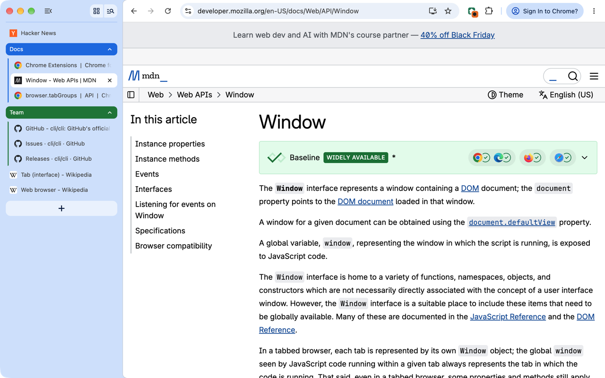
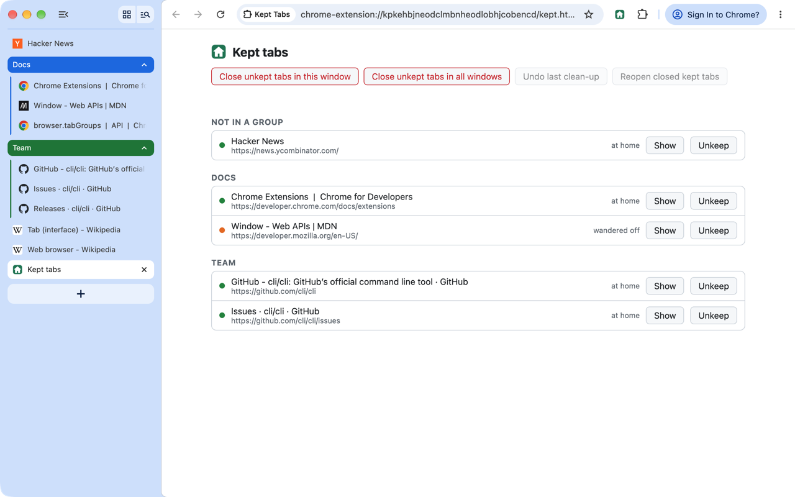
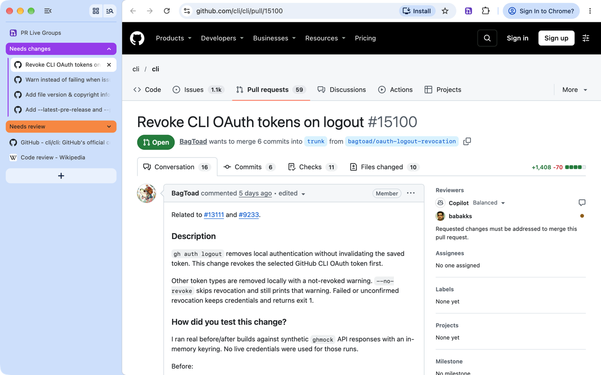
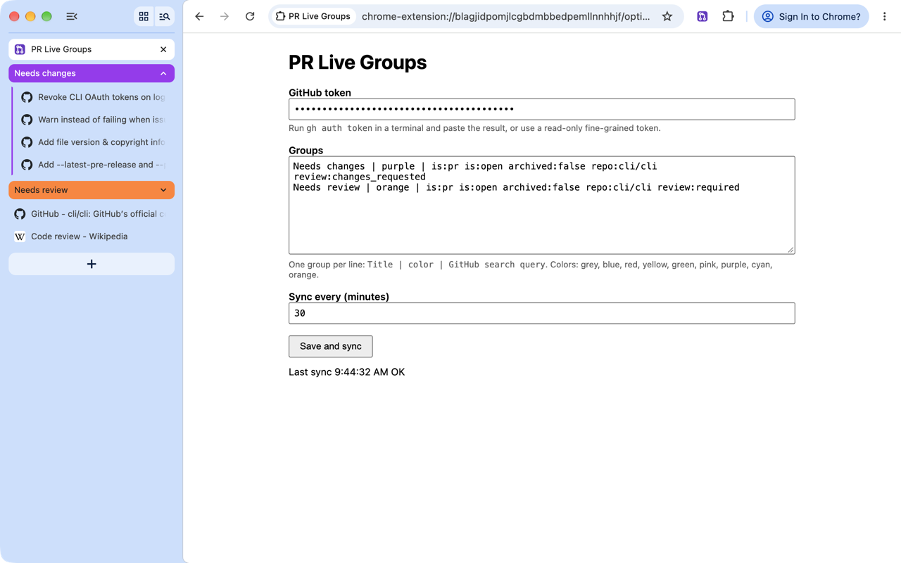
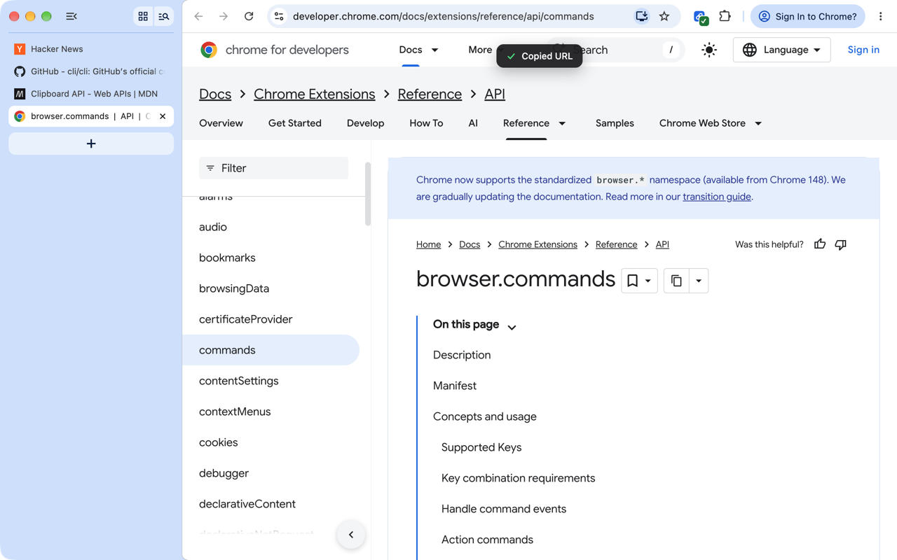

# Arc-style Chrome extensions

Three small Chrome extensions that bring back a few things people miss after moving from Arc to Chrome:

| Extension | What it does |
|---|---|
| [**Kept Tabs**](#kept-tabs) | Arc-style pinned tabs that can live anywhere, tab groups included. A kept tab has a home URL, and closing it reopens it at home. |
| [**PR Live Groups**](#pr-live-groups) | Keeps Chrome tab groups in sync with GitHub pull request searches, for example "my open PRs" and "PRs waiting for my review". |
| [**Copy URL**](#copy-url) | Arc's <kbd>⌘⇧C</kbd> (<kbd>Ctrl+Shift+C</kbd> on Windows and Linux): copies the current tab's URL and shows a "Copied URL" toast. |

Kept Tabs and PR Live Groups are built to be used with Chrome's **vertical tabs**: kept tabs and PR groups sit in the side tab list the way Arc's sidebar did. They work with the regular horizontal tab strip too.

All three are plain Manifest V3 extensions with no build step, no dependencies and no tracking. They need Chrome 120 or newer.



## Install

1. Download the zips you want (`kept-tabs-<version>.zip`, `pr-live-groups-<version>.zip`, `copy-url-<version>.zip`) from the [latest release](../../releases/latest).
2. Unzip each one into a folder you will keep, for example `~/Extensions/kept-tabs`. **Don't delete or move this folder later:** Chrome loads the extension from it.
3. Open `chrome://extensions` and turn on **Developer mode** (top right).
4. Click **Load unpacked** and pick the unzipped folder.
5. Pin the extension's icon to the toolbar (puzzle-piece menu → pin) so it's one click away.

To run from source instead, clone this repo and use **Load unpacked** on `kept-tabs/`, `pr-live-groups/` or `copy-url/`.

### Updating

Replace the contents of the same folder with the new release, then click the reload icon on the extension's card in `chrome://extensions`.

Keep the folder path the same. Chrome derives an unpacked extension's ID from its path, so loading a new version from a different folder installs it as a new extension and your kept tabs and settings stay behind with the old one.

## Kept Tabs

Chrome pinned tabs are stuck at the far left of the window and can't go in a tab group. A **kept tab** is an ordinary tab that the extension remembers:

- It has a **home URL**, the page it was on when you kept it.
- **Closing it reopens it** in the background, at its home URL, in the same window, group and position.
- If you browse away from home, the toolbar badge turns orange. One click takes you back.
- Kept tabs survive browser restarts. On startup the extension matches them to restored tabs by URL and reopens any that are missing.

In the screenshot above, Hacker News, the two Chrome/MDN docs and the two `cli/cli` tabs are kept. The active MDN tab has wandered off its home page, so the toolbar icon shows an orange dot. The tab list itself doesn't mark kept tabs, so the toolbar icon and the manager page are where you see them.

### Using it

The toolbar icon shows the state of the current tab:

| Badge | Meaning | Clicking the icon |
|---|---|---|
| none | Not kept | Keeps the tab, with the current page as home |
| 🟢 green dot | Kept, at home | Does nothing |
| 🟠 orange dot | Kept, wandered off | Goes back to the home URL |

"At home" compares origin and path only, so a different query string or `#hash` still counts as home.

Right-click the page or the toolbar icon for the rest:

- **Keep this tab**
- **Set current page as home**: changes the home URL to whatever the tab is showing now
- **Go to home page**
- **Stop keeping this tab**: do this before closing a kept tab you actually want gone, otherwise it comes back
- **Close all unkept tabs in this window** (toolbar icon menu only)
- **Kept tabs…** (toolbar icon menu only): opens the manager page

### Keyboard shortcuts

| Shortcut (macOS: ⌥⇧) | Action |
|---|---|
| `Alt+Shift+K` | Keep or stop keeping the current tab |
| `Alt+Shift+H` | Send the current kept tab back home |
| `Alt+Shift+X` | Close all tabs in this window except kept and pinned ones |

Change them at `chrome://extensions/shortcuts`. If another extension already uses a combination, Chrome leaves it unassigned and you have to set it there.

### Manager page

**Kept tabs…** in the toolbar menu (or **Extension options**) lists every kept tab by group, with its state: at home, wandered off, or closed with its window.



From there you can:

- **Show** or **Reopen** a kept tab, and **Unkeep** it
- **Close unkept tabs** in this window or in all windows. Pinned tabs, kept tabs and the manager page itself always stay open.
- **Undo last clean-up**: reopens the tabs the last clean-up closed, in their original groups. Only the most recent clean-up is remembered.
- **Reopen closed kept tabs**: brings back kept tabs whose window was closed

### Good to know

- Closing a whole **window** doesn't reopen its kept tabs right away. They're marked "closed with its window" and come back on the next browser start, or from the manager page.
- When a kept tab's tab group no longer exists, it's reopened in a new group with the same name and color.
- Everything is stored locally in `chrome.storage.local`. Nothing leaves your machine.

## PR Live Groups

PR Live Groups runs GitHub searches on a timer and makes a collapsed tab group hold exactly the PRs each search returns. By default you get two groups:

| Group | Color | Search |
|---|---|---|
| PRs | purple | `is:pr is:open archived:false author:@me` |
| Reviews | orange | `is:pr is:open archived:false user-review-requested:@me` |

When a PR shows up in a search, its tab is opened in the group. When it drops out (merged, closed, review done), its tab is closed. Click the toolbar icon to sync right away.



The screenshot uses two demo groups on the public `cli/cli` repo: **Needs changes** (expanded) and **Needs review** (collapsed, 15 PRs).

### Setup

1. Right-click the toolbar icon → **Options**.
2. Paste a GitHub token (see below).
3. Optionally edit the groups and the sync interval, then click **Save and sync**.

Groups are one per line, in the form `Title | color | GitHub search query`. Colors are `grey`, `blue`, `red`, `yellow`, `green`, `pink`, `purple`, `cyan` and `orange`. The query uses [GitHub search syntax](https://docs.github.com/en/search-github/searching-on-github/searching-issues-and-pull-requests). For example:

```
PRs | purple | is:pr is:open archived:false author:@me
Reviews | orange | is:pr is:open archived:false user-review-requested:@me
Team | blue | is:pr is:open org:my-org team-review-requested:my-org/my-team
```

The sync interval defaults to 1 minute and can't go below 0.5.



### GitHub token

The extension only reads search results, so it needs a token with read access to the repositories you want to see:

- **Quickest:** run `gh auth token` and paste the output. This works, but it's your full GitHub CLI token, with all of its scopes.
- **Recommended:** create a [fine-grained personal access token](https://github.com/settings/personal-access-tokens/new) with read-only **Pull requests** (and **Metadata**) access on the repositories or organization you care about. Some organizations need to approve fine-grained tokens before they work.

The token is stored unencrypted in the extension's local storage on your machine and is only sent to `api.github.com`.

### Good to know

- Each group holds at most **15 PRs**, the most recently updated ones.
- A group is matched by **title**, in any window. If it doesn't exist, it's created in the last focused window. Rename it in Chrome and the extension creates a fresh one on the next sync.
- Inside a synced group, the extension closes PR tabs that are no longer in the search results, and duplicate tabs for the same PR. It **never closes the active tab**, so a PR you're looking at stays open until you switch away. Tabs in the group that aren't PR pages are left alone.
- A PR tab you browse within (Files changed, Checks, a specific commit) still counts as that PR.
- If a sync fails, the toolbar icon shows a red **!**. Hover it to see the error, or check the options page, which shows the time and result of the last sync.
- GitHub's search API allows 30 requests per minute, and each group uses one request per sync. That leaves plenty of room unless you add a lot of groups and set a very short interval.

## Copy URL

Press <kbd>⌘⇧C</kbd> (<kbd>Ctrl+Shift+C</kbd> on Windows and Linux) to copy the current tab's URL, like in Arc. A "Copied URL" toast appears at the top of the page, and the toolbar icon shows a green ✓ for a moment. Clicking the toolbar icon copies the URL too.



### Set the shortcut (one time)

Chrome already uses <kbd>⌘⇧C</kbd> / <kbd>Ctrl+Shift+C</kbd> for DevTools' "inspect element", so it won't hand that key to a newly installed extension on its own. On install, Copy URL opens a page that walks you through it:

1. Open `chrome://extensions/shortcuts`.
2. Find **Copy URL** and click the pencil next to "Copy the current tab's URL".
3. Press <kbd>⌘⇧C</kbd> (or <kbd>Ctrl+Shift+C</kbd>).

Any other combination works too if you'd rather keep the DevTools one.

### Good to know

- The copy works on every page, including `chrome://` pages, the Chrome Web Store and PDFs. Extensions can't draw on those pages, so the toast doesn't appear there, only the ✓ on the toolbar icon (if it's pinned).
- It copies exactly what's in the address bar, `#hash` and query string included.
- It only reads the URL of the tab you invoke it on, when you invoke it. That's why Chrome shows no permission warning on install.

## Repository layout

```
kept-tabs/              Kept Tabs extension (load this folder unpacked)
pr-live-groups/         PR Live Groups extension (load this folder unpacked)
copy-url/               Copy URL extension (load this folder unpacked)
scripts/package.sh      Builds the release zips and Chrome Web Store zips into dist/
scripts/screenshots.mjs Regenerates docs/screenshots/ (see the comment at the top of the file)
docs/screenshots/       README screenshots, 1280x800 so they can be reused on the Web Store
STORE.md                Chrome Web Store listing text, permission justifications and privacy answers
.github/workflows/      Publishes a GitHub release when a v* tag is pushed
```

## Releasing

1. Bump `version` in the `manifest.json` of each extension that changed.
2. Add an entry to [CHANGELOG.md](CHANGELOG.md).
3. Commit, then tag and push:

   ```sh
   git tag v0.2.0
   git push origin main v0.2.0
   ```

The [release workflow](.github/workflows/release.yml) runs `scripts/package.sh` and attaches a `<extension>-<version>.zip` for each extension to a new GitHub release. To build the zips locally, run `scripts/package.sh` and look in `dist/`.

`scripts/package.sh` also writes `dist/store/<extension>-<version>.zip`, with `manifest.json` at the root of the zip, which is the layout the Chrome Web Store upload expects. See [STORE.md](STORE.md) for the listing.
